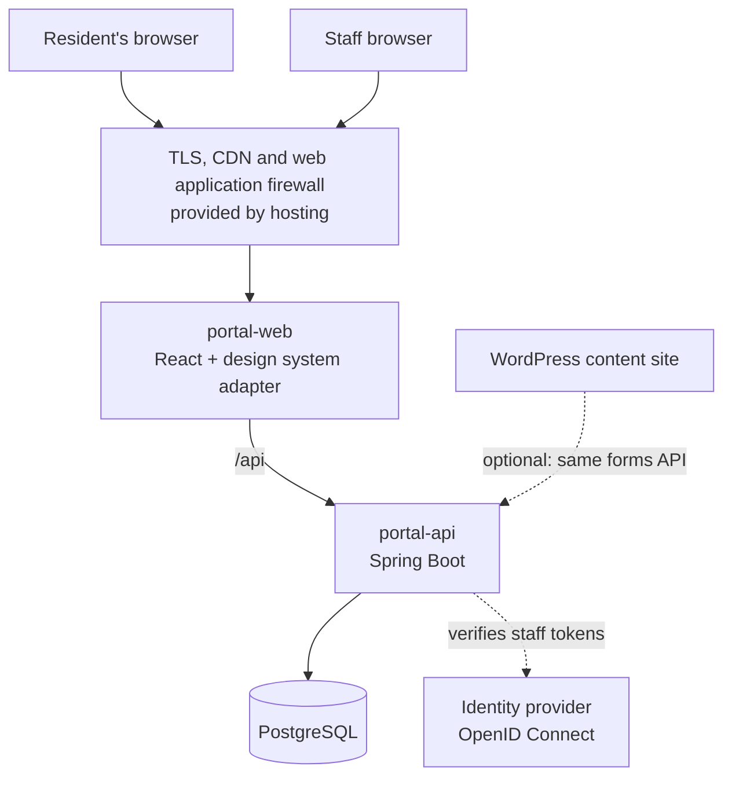
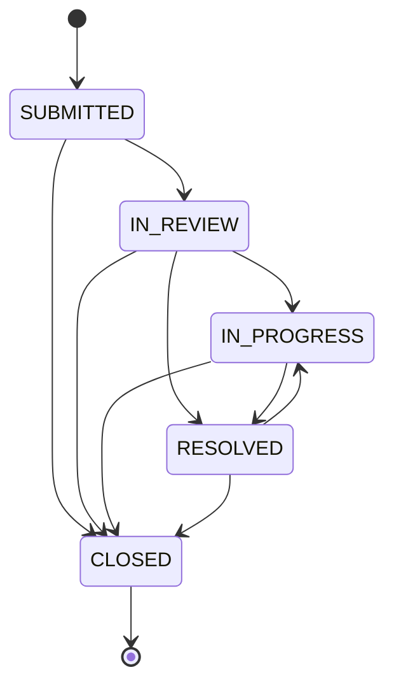

# Architecture

The portal is three parts: a React frontend that only presents, a Spring Boot API that holds every rule, and a PostgreSQL database. WordPress is a separate track for content sites, and it can call the same API for forms and service requests.

## Components

| Component | Responsibility | Code |
| --- | --- | --- |
| portal-web | Shows forms and results. No business rules. | `apps/portal-web` |
| Design system adapter | The only code that knows USWDS markup and classes | `apps/portal-web/src/ui/` |
| portal-api | Validation, categories, status rules, reference numbers, audit log, access control | `apps/portal-api` |
| PostgreSQL | Service requests, form submissions, audit events | `apps/portal-api/src/main/resources/db/migration` |
| Identity provider | Staff sign-in and MFA. Chosen per client. | Configured with `OIDC_ISSUER_URI` |
| WordPress starter | Editable content sites | `wordpress/` |

## Design system

Use the client's own design system when it has one. Otherwise use USWDS for local and federal projects and MDWDS for Maryland state projects; Maryland's [Digital Playbook](https://digital.maryland.gov/) provides MDWDS components and guidance.

Feature code imports components only from `apps/portal-web/src/ui/`. Switching design systems means rewriting that folder, not the features or the API. Per-client colors live in `src/theme/tokens.css`; for deeper USWDS changes, compile USWDS from Sass with the client's theme settings.

## API

| Method and path | Who | What it does |
| --- | --- | --- |
| `GET /api/service-requests/categories` | Public | Request types for this client |
| `POST /api/service-requests` | Public | Submit a request; returns a tracking number (`SR-` + 10 characters) |
| `GET /api/service-requests/{trackingNumber}` | Public | Status only; never contact details or description |
| `GET /api/staff/service-requests` | Staff | Paged list with contact details, optional `?status=` |
| `PATCH /api/staff/service-requests/{id}/status` | Staff | Move to an allowed next status; audited |
| `GET /api/forms/{formKey}` | Public | Form definition the frontend renders |
| `POST /api/forms/{formKey}/submissions` | Public | Submit a form; returns a reference number (`FM-` + 10 characters) |
| `GET /api/staff/forms/{formKey}/submissions` | Staff | Paged submissions |
| `GET /actuator/health` | Public | Health check for monitoring, served as `/healthz` through the web proxy |

Errors use the standard problem format (RFC 9457). Field problems come back as `{"errors": {"field": "message"}}`, written in plain language for residents.

## Data flows

**A resident submits a service request**

1. The browser sends the form to `POST /api/service-requests` over HTTPS.
2. The API checks every field, rejects unknown categories and the hidden spam trap, and creates a hard-to-guess tracking number.
3. The request and an audit event are saved in one database transaction.
4. The resident sees the tracking number. Contact details are never returned to the public.

**Staff update a request**

1. Staff sign in with the client's identity provider, which issues a token with the `portal.staff` scope.
2. The API checks the token, then checks that the status change is allowed (for example, `CLOSED` can't reopen).
3. The change and an audit event naming the staff member are saved together.

**Status lifecycle**

## Per-client configuration

| What | Where |
| --- | --- |
| Request categories, forms and allowed origins | `application-<client>.yml` (start with `SPRING_PROFILES_ACTIVE=<client>`) |
| Site name, phone, category labels | `apps/portal-web/src/config/site.ts` |
| Colors | `apps/portal-web/src/theme/tokens.css` |
| Secrets and URLs | Environment variables (`deploy/.env.example`) |

## Integrations (planned)

Each integration will be a module with one interface in the API, so a client can swap vendors without touching the rest:

| Module | Typical outside products | Status |
| --- | --- | --- |
| Payments | Client's payment processor | Not started |
| Agendas and meetings | CivicClerk, BoardDocs, Granicus | Not started |
| 311 and work orders | Client's 311 or asset management system | Not started |
| Alerts | Client's email/SMS alert service | Not started |
| Maps | ArcGIS or client GIS | Not started |

[CLIENT] List the integrations this client needs, with the vendor, the data exchanged and who owns the account.
